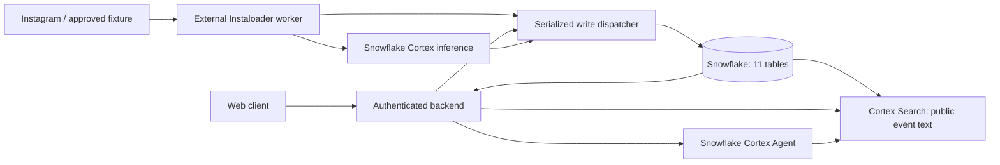

# Purdue club feed — implementation handoff

**Start here:** the database owner runs the five-step Snowflake checklist in §9. Teammate agents implement the contracts in §4–7 against the 11 tables in §2. SQL files are in [`snowflake/`](snowflake/).

Version: **v1.0 · 2026-10-25**. Status: **design and setup files prepared; not deployed or tested against a Snowflake account**.

## 0. Scope and decision record

The supplied architecture conversation establishes Instagram ingestion with Instaloader, a newsletter feed of followed accounts, a personalized upcoming Purdue club event feed, and Snowflake-hosted retrieval and agent inference. The user owns the database schema. **The conversation export exposes earlier assistant answers only as reference placeholders, so their exact table names and columns could not be recovered. This document reconstructs a concrete 11-table contract from the visible requirements; it is not a verbatim recovery of the previously accepted table list.**

For this handoff, use these decisions without blocking on framework choices:

| Decision | v1 contract |
|---|---|
| Database | Snowflake standard tables in `HACKATHON_DB.APP`; all application data there. |
| Auth | Email + password, implemented in the Flask backend (`auth.py`). No OAuth/external auth provider. `USERS.PASSWORD_HASH` stores a salted werkzeug hash (scrypt/pbkdf2), never the plain-text password. The browser holds only a signed Flask session cookie containing `USER_ID`. |
| Follows | Users follow Instagram accounts. Each account gets a `CLUBS` row automatically the first time it publishes an event (slug and name = the username), so every followed account's events can appear in the calendar. There is no club verification step. |
| Retrieval and agent | Cortex Search manages event embeddings; Cortex Agent `EVENT_ASSISTANT` uses the event search service. No separate vector database or manually maintained embedding columns. |
| Personalization | Backend combines follows, known tags, free-text preferences, current event facts, and search rank. The model proposes interpretations; deterministic checks decide validity and eligibility. |
| Deployment | One backend instance and one serialized database write dispatcher for the hackathon. Instaloader runs outside Snowflake. Model inference and event search run inside Snowflake. |
| Newsletter | On-demand feed/summary, not scheduled email delivery. No delivery or newsletter-history table in v1. |
| Workflow | Move quickly; ask only high-level architectural questions when blocked. Explain proposed code changes before editing implementation. This handoff adds documentation and unexecuted setup SQL only. |

**Not represented in the 11 tables:** email delivery history, behavioral analytics, ingestion-run history, multiple independent hosting clubs per event, recurring-event rules, auth sessions, or a migration ledger. Use structured runtime logs for jobs. Add a new migration if these become product requirements; do not hide a new table in another agent's work.

## 1. Architecture and ownership



| Owner / teammate lane | Owns | Must hand off |
|---|---|---|
| Database owner — user | Schema, identifiers, tag vocabulary, migrations, Snowflake roles and grants | These contracts and a working test namespace; only this lane changes DDL. |
| Instagram / newsletter teammate | Username resolution, Instaloader adapter, raw post ingestion, newsletter composition | Normalized ingestion batches; post provenance; visible ingestion failures; newsletter response. |
| Event / RAG lane — user | OCR adapter if needed, extraction, evidence validation, deduplication, event tags, retrieval and ranking | Canonical events, source links, stable feed cards, grounded explanations. |
| Backend / integration teammate | Auth, API routes, Snowflake connection pools, serialized writes, secrets, request validation | The endpoints below; strict private-user scoping; retry/cache behavior. |
| Frontend teammate | Username follow controls, preferences, newsletter and event feeds | Uses API only; displays unknown time/cost correctly and links to source posts. |

One teammate may fill several lanes. Nobody independently renames columns, changes IDs, runs competing migrations, or exposes Snowflake credentials in the browser.

## 2. Eleven-table schema

**Authoritative column types, nullability, defaults and named keys:** [`002_schema.sql`](snowflake/002_schema.sql). Names are unquoted uppercase in SQL; JSON uses `snake_case`. `?` below means nullable; all other fields are required or have SQL defaults.

### 2.1 Identity and preferences

| # / table | Key and relationships | Columns / purpose |
|---|---|---|
| 1. `USERS` | PK `USER_ID`; natural unique `EMAIL` (and `AUTH_SUBJECT`) | `USER_ID`, `AUTH_SUBJECT` (always `local:<email>`; kept so an auth provider can be added later), `EMAIL` (lowercased, required, the login key), `PASSWORD_HASH` (werkzeug hash; plain text is never stored), `DISPLAY_NAME?`, `TIMEZONE`, `CREATED_AT`, `UPDATED_AT`, `DELETED_AT?`. Sign-up checks for an existing email inside the insert transaction because Snowflake does not enforce `UNIQUE`. |
| 2. `USER_PREFERENCES` | PK/FK `USER_ID → USERS`; exactly one row per active app user | `PREFERENCE_TEXT`, `INTEREST_TAG_IDS` (array of active tag-ID strings), `EXCLUDED_TAG_IDS` (same), `FOLLOWED_ONLY`, `FREE_ONLY`, `HORIZON_DAYS` (1–90, default 30), `VERSION`, `UPDATED_AT`. User creation creates an empty default preference row in the same transaction. |
| 3. `USER_FOLLOWS` | Composite PK `(USER_ID, ACCOUNT_ID)`; FKs to `USERS` and `INSTAGRAM_ACCOUNTS` | `USER_ID`, `ACCOUNT_ID`, `CREATED_AT`. Unfollow deletes this relationship; never deletes the shared account. |

Interest arrays deliberately avoid a twelfth join table. Validate every array element against `TAGS`, remove duplicates, and reject overlap between included and excluded tags. Do not mix tag labels with IDs. Saved prose remains available for semantic retrieval even when it maps to no known tags.

### 2.2 Clubs and taxonomy

| # / table | Key and relationships | Columns / purpose |
|---|---|---|
| 4. `CLUBS` | PK `CLUB_ID`; natural unique `SLUG` | `NAME`, `DESCRIPTION?`, `CAMPUS` (default `purdue-west-lafayette`), `WEBSITE_URL?`, `IS_ACTIVE`, `CREATED_AT`, `UPDATED_AT`. Slug is a stable application label. Auto-created from the Instagram account; it is not an official Purdue endorsement. |
| 5. `INSTAGRAM_ACCOUNTS` | PK `ACCOUNT_ID`; natural unique normalized `USERNAME`; unique `INSTAGRAM_USER_ID?`; optional FK `CLUB_ID → CLUBS` | `DISPLAY_NAME?`, `BIO?`, `PROFILE_URL`, `IS_ACTIVE`, `INGESTION_STATUS`, `LAST_ATTEMPT_AT?`, `LAST_SUCCESS_AT?`, `NEXT_RETRY_AT?`, `LAST_ERROR?`, `CREATED_AT`, `UPDATED_AT`. Many accounts may map to one club; one account maps to at most one club. |
| 6. `TAGS` | PK `TAG_ID`; natural unique `SLUG` | `LABEL`, `CATEGORY`, `DESCRIPTION?`, `IS_ACTIVE`, `CREATED_AT`. Categories: `topic`, `activity`, `audience`, `format`. Curated vocabulary; extraction cannot create new tags. |
| 7. `CLUB_TAGS` | Composite PK `(CLUB_ID, TAG_ID)`; FKs to `CLUBS`, `TAGS` | `SOURCE` (`manual` or `extracted`), `CONFIDENCE?`, `CREATED_AT`. General club interests, separate from a particular event's subject. |

Seed a small curated vocabulary before extraction: e.g. `artificial-intelligence`, `robotics`, `arts`, `sports`, `volunteering` under `topic`; `workshop`, `social`, `career` under `activity`; `beginner-friendly` under `audience`; `virtual` under `format`. These are suggested seed labels, not claims about real clubs. Free admission is a structured event fact, not inferred from a tag.

### 2.3 Posts, canonical events and evidence

| # / table | Key and relationships | Columns / purpose |
|---|---|---|
| 8. `POSTS` | PK `POST_ID`; natural unique `SHORTCODE`; unique `INSTAGRAM_MEDIA_ID?`; FK `ACCOUNT_ID → INSTAGRAM_ACCOUNTS` | `PERMALINK`, `POSTED_AT`, `CAPTION?`, `MEDIA_TYPE`, `MEDIA_URLS`, `OCR_TEXT?`, `RAW_PAYLOAD?`, `CONTENT_HASH`, `EXTRACTION_STATUS`, `EXTRACTION_VERSION?`, `EXTRACTED_PAYLOAD?`, `ATTEMPT_COUNT`, `LEASE_EXPIRES_AT?`, `LAST_ERROR?`, `INGESTED_AT`, `SOURCE_SEEN_AT`, `UPDATED_AT`, `DELETED_AT?`. Preserve raw content independently of derived event facts. |
| 9. `EVENTS` | PK `EVENT_ID`; natural unique `DEDUPE_KEY`; FK `CLUB_ID → CLUBS` | `TITLE`, `DESCRIPTION?`, `START_AT?`, `END_AT?`, `LOCAL_START_DATE?`, `EVENT_TIMEZONE`, `DATE_PRECISION`, `LOCATION_NAME?`, `LOCATION_ADDRESS?`, `LOCATION_URL?`, `REGISTRATION_URL?`, `PRICE_AMOUNT?`, `PRICE_CURRENCY`, `IS_FREE?`, `STATUS`, `CONFIDENCE?`, `EXTRACTION_VERSION?`, `SEARCH_TEXT`, `REVISION`, `CREATED_AT`, `UPDATED_AT`. One row per actual occurrence. |
| 10. `EVENT_TAGS` | Composite PK `(EVENT_ID, TAG_ID)`; FKs to `EVENTS`, `TAGS` | `SOURCE` (`manual` or `extracted`), `CONFIDENCE?`, `CREATED_AT`. Direct event tags. The feed may also use inherited club tags without duplicating them here. |
| 11. `EVENT_SOURCES` | Composite PK `(EVENT_ID, POST_ID)`; unique `(POST_ID, SOURCE_EVENT_KEY)`; FKs to `EVENTS`, `POSTS` | `SOURCE_EVENT_KEY`, `IS_PRIMARY`, `EVIDENCE`, `SOURCE_CONTENT_HASH`, `EXTRACTION_VERSION`, `CREATED_AT`, `UPDATED_AT`. Many posts can describe one event; one post can describe many events. Evidence identifies supporting caption/OCR fields. Exactly one primary live source per published event, enforced by writer. |

`MEDIA_URLS` may expire. The permanent citation is the Instagram `PERMALINK`. Frontend handles a missing image; do not depend on a signed CDN URL as permanent storage. `RAW_PAYLOAD` must exclude cookies, access tokens and account/session credentials.

### 2.4 Keys, enforcement and serialization

Snowflake standard-table PK, FK and UNIQUE declarations do **not** enforce uniqueness or relationships. `NOT NULL` is enforced. The write layer must validate references and all enumerations/ranges below. See [Snowflake constraints](https://docs.snowflake.com/en/sql-reference/constraints).

| Entity / invariant | Implementation contract |
|---|---|
| IDs | Backend-generated UUID strings fit `VARCHAR(64)`. `POST_ID` may instead be lowercase SHA-256 of `instagram:post:<shortcode>`. Choose this deterministic post form for v1. Never use an Instagram numeric ID as a JavaScript number; preserve strings. |
| Account normalization | Trim whitespace, strip one leading `@`, lowercase; validate `^[a-z0-9._]{1,30}$`. Endpoint accepts handles only, not arbitrary URLs. On rename, preserve `ACCOUNT_ID` using the known external `INSTAGRAM_USER_ID`; do not transfer a follow solely because a handle was recycled. |
| Event dedupe | SHA-256 of UTF-8 canonical JSON with sorted keys and compact separators: `{club_id, local_start_date, local_start_time, normalized_title}`. Date is `YYYY-MM-DD`; time `HH:mm` or `date-only`; title is Unicode NFC, lowercase, trimmed, with whitespace collapsed. Preserve punctuation. A probable near-match with changed title/time needs evidence reconciliation, not automatic deletion. |
| Stable event identity | Once assigned, `EVENT_ID` survives confirmed edits/rescheduling. Update its dedupe key in the same transaction. Reconcile an existing source occurrence before creating a new event. Never make the ID equal to the mutable dedupe key. |
| Source occurrence | `SOURCE_EVENT_KEY` is a writer-assigned stable UUID for an occurrence within a post, retained across extraction versions. Match re-extraction to existing occurrences by dates/title/evidence. Ambiguous matches stay in review; array order from a model is not a stable key. |
| Serialized mutations | All API and worker mutations go through one backend write dispatcher in v1, including account registration and follows. Workers do not race direct SQL writes. One `MERGE` per logical key plus serialization provides retry safety; `MERGE` by itself is not a concurrent uniqueness constraint. Before scaling to multiple writer instances, add a real external lock/queue or redesign storage constraints. |

Use parameter binding for values; SQL object names come from fixed configuration. Never execute SQL generated from user text. DML groups use explicit transactions on one connection; Snowflake DDL is not an all-or-nothing migration transaction. `UPDATED_AT`, preference `VERSION`, and event `REVISION` must be updated by the application; no automatic update trigger exists here.

### 2.5 Values and publication rules

| Field | Allowed meaning |
|---|---|
| `INGESTION_STATUS` | `pending`, `ok`, `retry`, `blocked`, `disabled`. Private/missing/login-blocked accounts expose a visible state, not a successful empty scrape. |
| `MEDIA_TYPE` | `image`, `video`, `carousel`. Inspect all relevant carousel images; do not assume the first image contains the flyer. |
| `EXTRACTION_STATUS` | `pending`, `processing`, `processed`, `failed`. A successful non-event result is `processed` with `events: []`. |
| Event `STATUS` | `draft`, `published`, `cancelled`, `archived`. Expired events can remain `published`; the read-time date gate excludes them. Cancellation is a fact backed by evidence, not a missing-post inference. |
| `DATE_PRECISION` | `exact`, `date_only`, `unknown`. `exact`: supported date and clock time. `date_only`: supported day but no clock time. `unknown`: not publishable. |
| Money and confidence | `IS_FREE = NULL` means unknown, not free. `PRICE_AMOUNT >= 0` if present; `IS_FREE=TRUE` requires explicit evidence and amount null or 0. Confidence is null or 0–1; it is a model signal, not a calibrated probability. |

Publish only when the club is active, the title is nonempty, date evidence resolves to a real occurrence, `START_AT` and `LOCAL_START_DATE` agree in `EVENT_TIMEZONE`, and a live source with field evidence exists. `END_AT`, if known, must be later than `START_AT`. Unknown location or cost can remain null and must be displayed as unknown. Set a conservative initial model-confidence gate of 0.8 **in addition to** field evidence; manual review can publish verified facts without a model score.

Store instants as `TIMESTAMP_TZ`; set connection timezone to UTC. Preserve the IANA zone separately because an offset does not encode future DST rules. Purdue West Lafayette default: `America/Indiana/Indianapolis`. For `date_only`, encode local midnight as `START_AT` for sorting, preserve `DATE_PRECISION`, and display **“Time not announced”**, never “12:00 AM.” `END_AT` stays null unless an end is supported. Do not guess a missing year: resolve only with explicit surrounding source context or leave draft. Relative dates must use the post's local date, not the extraction date.

## 3. Shared payloads

### 3.1 Ingestion batch — worker → trusted backend

`POST /internal/v1/ingestion/batches` uses a deployment secret or equivalent service authentication, never ordinary frontend auth. Limit 100 posts per batch. Backend uses the ingest Snowflake role internally. Do not allow callers to supply arbitrary table names or SQL.

```json
{
  "schema_version": 1,
  "batch_id": "worker-generated-uuid",
  "account_id": "existing-account-uuid",
  "fetched_at": "2026-10-25T19:00:00Z",
  "posts": [{
    "shortcode": "DEMO_ONLY",
    "instagram_media_id": "12345678901234567890",
    "permalink": "https://www.instagram.com/p/DEMO_ONLY/",
    "posted_at": "2026-10-25T18:00:00Z",
    "caption": "Demo robotics workshop October 28, 2026 at 6 PM in Demo Hall.",
    "media_type": "image",
    "media_urls": [],
    "ocr_text": null,
    "raw_payload": {"fixture": true}
  }]
}
```

Everything above is synthetic. Batch response: `{batch_id, inserted, updated, unchanged, rejected:[{shortcode,code}]}`. A batch ID is a log correlation value, not a persisted exactly-once guarantee. Idempotency is per shortcode and content hash. Validate the whole envelope before processing; each accepted post is an independent transaction and receives one outcome. Request-level errors are `400/401/403/413`; successful batch handling is `200`, with per-post rejection codes if needed. Retry the same payload safely.

### 3.2 Extraction result — Cortex inference → event lane

Request structured JSON output from Snowflake inference, then validate it again in the backend. The model must return an array because posts can contain several events. The following is the normalized extraction boundary, with nulls explicit:

```json
{
  "schema_version": 1,
  "post_id": "sha256-assigned-by-worker",
  "source_content_hash": "current-post-content-sha256",
  "extraction_version": "events-v1:configured-model:prompt-v1",
  "events": [{
    "title": "Demo robotics workshop",
    "description": "A workshop announced by the demo club.",
    "local_start_date": "2026-10-28",
    "local_start_time": "18:00",
    "local_end_date": null,
    "local_end_time": null,
    "event_timezone": "America/Indiana/Indianapolis",
    "date_precision": "exact",
    "location_name": "Demo Hall",
    "location_address": null,
    "location_url": null,
    "registration_url": null,
    "price_amount": null,
    "price_currency": "USD",
    "is_free": null,
    "tag_ids": ["existing-robotics-tag-uuid", "existing-workshop-tag-uuid"],
    "confidence": 0.93,
    "evidence": {
      "title": [{"kind":"caption","quote":"Demo robotics workshop"}],
      "start": [{"kind":"caption","quote":"October 28, 2026 at 6 PM"}],
      "location": [{"kind":"caption","quote":"Demo Hall"}]
    }
  }],
  "warnings": []
}
```

The worker injects `post_id`, hash and version from trusted job context; a model cannot override them. Evidence `kind` is `caption` or `ocr`; OCR evidence additionally identifies `media_index`. Require a supporting excerpt for each non-null asserted date, time, location, cost and URL. Check excerpts against the captured source text; they are not instructions. Fields without support become null or block publication. Do not let the model assign `USER_ID`, `CLUB_ID`, stable source keys or final event IDs. The posting account's club determines the primary hosting club.

Store the validated result in `POSTS.EXTRACTED_PAYLOAD`, including warnings/review reasons. If the posting account has no club yet, the backend creates one from its username before publishing events.

## 4. Ingestion and extraction flow

### 4.1 Collect posts

1. Resolve a normalized account handle. The backend reuses an existing account or registers it once and saves the follow. Its club is created automatically when its first event is published.
2. Fetch up to 50 recent posts per account, initially covering 30 days. Recheck a seven-day overlap on later runs to detect edits. Use pagination and the newest stored `POSTED_AT` as an optimization, not a guarantee that older edits cannot exist.
3. Normalize text and compute `CONTENT_HASH` as SHA-256 of canonical JSON containing caption, media IDs/permanent identifiers, and any OCR text. Exclude fetch timestamps and expiring URL query strings. A hash change or extraction-version change queues re-extraction; unchanged content only updates `SOURCE_SEEN_AT` and refreshed media URLs.
4. Write with bound parameters through the serialized dispatcher. Update account attempt/success state. An empty valid profile is different from a failed scrape. Keep a structured log keyed by `batch_id` and account ID.
5. Retry transient failures with bounded backoff; on access barriers or rate limits, expose `blocked`/`retry` and use an explicitly labeled fixture for the demo if needed. Never treat a failed scan as proof of post deletion.

Default scheduler interval: 15 minutes during the demo, one account at a time; this is a project choice, not an Instagram quota guarantee. Store Instaloader session material only in deployment secrets. Instaloader makes outbound requests from the external worker, so Snowflake external network access, Snowpipe, Kafka and Snowpark containers are not required for v1.

### 4.2 Extract, reconcile and publish

1. Claim one `pending` post using the serialized dispatcher: set `processing`, increment attempts, save a two-minute lease and capture the content hash. Read caption plus available OCR; caption-only extraction must state that images were not read.
2. Call Snowflake-hosted inference using a configured model available in this account. Schema-constrained output follows §3.2. An OCR adapter may run outside Snowflake, but it must not be silently replaced with made-up image facts. If OCR is unavailable, image-only announcements remain unresolved.
3. Check evidence, timezone, tag IDs, publication rules and existing source occurrences. New confirmed occurrence → new UUID; exact dedupe match → attach source to existing event; confirmed edit → preserve event UUID; conflicting/ambiguous announcements → review in the extracted payload and keep the affected event draft until reconciled. Co-hosted events get one primary club in v1.
4. In one DML transaction, recheck the post hash, update `EVENTS`, reconcile `EVENT_TAGS` and `EVENT_SOURCES`, select exactly one primary live source, rebuild `SEARCH_TEXT`, increment event revision, and mark the post `processed`. Reject stale extraction when the stored hash changed. Re-extraction must retire obsolete source links; an event with no remaining live support becomes draft/archived. Explicit cancellations preserve their supported source and set `cancelled`.
5. On failure, release the lease and retry at most three total attempts for that content/version (suggested delays 5, 30, 120 seconds). After the third failure mark `failed`; a manual retry or new hash/version resets attempts. Expired leases can be reclaimed; do not hold a database transaction open while waiting on the model.

`SEARCH_TEXT` is a deterministic, server-assembled text field: event ID, title, factual description, club name, local date/time with precision, supported location, known cost, and active direct/inherited tag labels. No private user preferences, raw model instructions, or credentials enter it. The event lane rebuilds affected events when club names/tags or event facts change. Do not rely on the model to keep this materialized field synchronized.

## 5. Preference validation and natural-language search

**RAG grounds meaning; it does not certify input as true or safe.** Apply request-size limits and schema checks first. Retrieval can map a phrase to real clubs/tags/events. It cannot prove an event time that is absent from the source.

| Boundary | Rule |
|---|---|
| Saved preference text | Max 2,000 characters. Preserve the user's text. Model proposes only existing tag IDs and allowlisted filters; validate with the database. |
| Search query | Max 500 characters. Interpret supported dates/filters using server time and the user's IANA zone; query text is bound data. |
| Unsupported terms | Return `unmatched_terms`; keep useful semantic text. Do not create tags or claim nonexistent clubs exist. |
| Hard constraints | Excluded tags, followed-only, free-only and date bounds are enforced by the backend even if the model ignores them. Free-only excludes unknown cost. |
| Private context | Only the verified caller's preferences reach that request's model context. Public Cortex Search contains no preference rows. Model/search errors never broaden access or drop hard constraints. |

`POST /v1/preferences/preview` returns `{proposed:{interest_tag_ids,excluded_tag_ids,followed_only,free_only,horizon_days}, unmatched_terms, warnings}` without saving. `PUT /v1/me/preferences` saves validated structured values and text with `expected_version`; a stale version returns `409`. Explicit UI controls win over inferred natural-language filters. Do not silently save a query as a lasting preference.

For tags, a bounded SQL lookup of the small curated vocabulary is sufficient. An additional tag search service is optional, not required or included in the setup.

## 6. Feed and agent behavior

### 6.1 Upcoming personalized event feed

1. Load the authenticated user's preferences and follows. Resolve explicit request filters against defaults, then determine a time window in their zone (default today through `HORIZON_DAYS` days ahead).
2. Form a candidate union: up to 100 followed-club/source events, 100 tag-match events, 100 Cortex Search results, and 100 earliest eligible fallback events. Search with explicit `q` if supplied, otherwise saved preference prose plus known tag labels. Skip semantic retrieval for empty text. Candidate limits are initial tuning values.
3. Deduplicate by `EVENT_ID` and hydrate current rows from Snowflake. Enforce active club, published status, a live primary source, date bounds, exclusions and requested filters. Search may lag; an indexed cancelled event is still excluded by the current row. Newly published events can enter through SQL candidates before indexing finishes.
4. Rank deterministically using the formula below. Include backend-generated reasons such as `followed_account`, `interest_tag`, `semantic_match` or `upcoming`; only emit a reason actually supported by this request's inputs.
5. Return source-linked cards. Optional Cortex Agent explanations are supplementary; the card's date, price, location and links always come from current stored facts.

An event counts as followed when **any** followed account maps to its primary club **or** a linked live source post belongs to a followed account. This supports club accounts and cross-posts. `followed_only` applies that same predicate. Personalization does not require following any accounts.

Hard date gates: for `exact`, require `START_AT >= request_now`; for `date_only`, require `LOCAL_START_DATE >= today's date in EVENT_TIMEZONE`. Both must fall within the requested inclusive local `from_date` / `through_date` range. Convert date boundaries using the event's zone; do not add a fixed 24 hours across DST. Unknown dates never appear in upcoming cards. Ongoing timed events are excluded in v1; changing this requires an explicit product decision.

Initial score (a design choice, not Snowflake's native score):

`score = 50*F + 30*T + 15*S + 5*U`

| Term | Exact calculation |
|---|---|
| `F` | 1 when followed by the rule above, otherwise 0. |
| `T` | Fraction of the user's unique interest tags present in the union of active event and club tags; 0 when no interests. |
| `S` | For semantic rank `r` in a maximum-100 search result: `(101-r)/100`; 0 if absent. Do not assume Search returns a calibrated similarity score. |
| `U` | `1 / (1 + days_until_event)`, with nonnegative local calendar-day difference. |

Tie-break by `START_AT ASC, EVENT_ID ASC`. Cold start with no follows, tags or text returns eligible events chronologically. A hard exclusion overrides a follow or a high score. If all candidates are removed, return an empty feed with a clear reason; do not silently relax filters. Candidate caps mean this v1 ranking is approximate over a bounded union, not a complete global recommendation optimizer.

### 6.2 Newsletter feed

Read non-deleted posts from the caller's followed accounts, default seven-day lookback, newest `POSTED_AT` first, tie-break `POST_ID`. Non-event posts are valid newsletter items. Do not manufacture an event from every post.

Optional Snowflake-hosted summarization groups these posts by account/topic and includes their source permalinks. Validate every referenced post ID against the authorized input set before returning the summary. On inference failure return the factual post list with `summary: null`. No email sending is implied. Newsletter generation must not trigger fresh scraping inline; show account ingestion state and last-success timestamps.

### 6.3 Cortex Agent integration

Create the actual Snowflake agent with [`004_search_agent.sql`](snowflake/004_search_agent.sql). Server-side endpoint:

`POST https://<account-host>/api/v2/databases/HACKATHON_DB/schemas/APP/agents/EVENT_ASSISTANT:run`

Minimal request body:

```json
{
  "stream": false,
  "messages": [{
    "role": "user",
    "content": [{"type":"text","text":"Find robotics workshops at Purdue this week."}]
  }]
}
```

Use server-side Snowflake REST authentication. Parse the documented content/citation structure; do not treat the entire response as a list of event cards. The agent is a discovery/explanation interface using the public event index. Backend-owned candidate retrieval/ranking remains the structured feed path. If an agent citation cannot be mapped to an existing eligible `EVENT_ID`, omit that card. Do not regex invented IDs from prose or trust narrative dates. For `/events/ask`, v1 constructs the final `answer` from current eligible card facts and source links using backend text templates; it does not forward unvalidated agent prose. This prevents an otherwise valid citation from carrying a stale date or bypassing a user's filters. No arbitrary SQL tool or user-table access is attached to this agent.

Cortex Search uses owner-rights access, so only approved public event text belongs in its source. Service USAGE is not a substitute for app-user authorization. [Search access model](https://docs.snowflake.com/en/user-guide/snowflake-cortex/cortex-search/cortex-search-overview). Agent requests and response formats are documented in the [Agents Run API](https://docs.snowflake.com/en/user-guide/snowflake-cortex/cortex-agents-run).

## 7. Public API contract

All public endpoints require the backend's verified user session. `/me` identity comes from the session, never a client-supplied `user_id`. Shared Snowflake backend roles can see multiple users; backend query scoping is mandatory. Do not expose raw Snowflake table APIs to the browser.

### 7.1 Routes

| Method / route | Request | Response / behavior |
|---|---|---|
| `GET /v1/me` | Session only | `{user_id,email,display_name,timezone}`. The user and default preferences are created at sign-up (`POST /signup`); `POST /login` and `POST /logout` manage the Flask session. |
| `GET /v1/me/preferences` | Session only | Saved text, structured fields and `version`. |
| `POST /v1/preferences/preview` | `{preference_text}` | Nonpersistent proposal and unmatched terms (§5). |
| `PUT /v1/me/preferences` | `{preference_text,interest_tag_ids,excluded_tag_ids,followed_only,free_only,horizon_days,expected_version}` | Validated saved preferences with incremented version; full replacement, no ambiguous partial merge. |
| `GET /v1/me/follows` | Session only | `{items:[{account_id,username,club_id,ingestion_status,last_success_at}]}`. |
| `PUT /v1/me/follows/{username}` | Normalized handle | Idempotent follow; `201` new / `200` existing, `{account_id,username,ingestion_status}`. Queue ingestion; no synchronous scrape. |
| `DELETE /v1/me/follows/{account_id}` | Known account ID | Idempotent `204`; does not alter other users or shared content. |
| `GET /v1/tags` | Optional category | Active curated tag IDs, slugs and labels. |
| `GET /v1/clubs` | Optional `q`, `tag_id`, `limit` | Active club metadata and associated account handles; bounded list. |
| `GET /v1/events` | `q?`, `from_date?`, `through_date?`, `followed_only?`, `free_only?`, `include_past?`, `limit?`, `cursor?` | Personalized structured feed below; limit default 20, max 50. `include_past=true` (used by the calendar) keeps already-started events in the date range and marks them `is_past`. Filter overrides apply to this request only. |
| `GET /v1/events/{event_id}` | Event ID | Current published event + sources, or `404` when draft/archived/unsupported; a supported cancelled event can return its status for an existing detail link. |
| `GET /v1/newsletter` | `days?` (1–30), `limit?` (default 20, max 50), `cursor?` | `{items:[{post_id,account,caption,posted_at,permalink,media_urls}],summary,next_cursor,meta}`. |
| `POST /v1/events/ask` | `{q}` | `{answer,citations:[{event_id,source_url}],warnings}`; validates citations and applies saved hard filters before returning event claims. Empty eligible grounding → answer that no matching supported events were found. |

`from_date` / `through_date`: ISO `YYYY-MM-DD`; inclusive calendar-day filters, default user-local today through today + horizon. Reject reversed or wider-than-90-day ranges. For displayed events use their own event zones as described in §6; all v1 Purdue events default to the same zone. Reject malformed timestamps/filters rather than asking the model to repair them.

### 7.2 Event feed response

```json
{
  "items": [{
    "event_id": "event-uuid",
    "club": {"club_id":"club-uuid","name":"Demo Robotics Club"},
    "title": "Demo robotics workshop",
    "description": "A workshop announced by the demo club.",
    "start_at": "2026-10-28T22:00:00Z",
    "end_at": null,
    "local_start_date": "2026-10-28",
    "event_timezone": "America/Indiana/Indianapolis",
    "date_precision": "exact",
    "location_name": "Demo Hall",
    "is_free": null,
    "price_amount": null,
    "price_currency": "USD",
    "registration_url": null,
    "tags": [{"tag_id":"tag-uuid","label":"Robotics","inherited":false}],
    "status": "published",
    "reasons": ["followed_account", "interest_tag"],
    "source_posts": [{"post_id":"post-sha256","url":"https://www.instagram.com/p/DEMO_ONLY/","is_primary":true}],
    "updated_at": "2026-10-25T19:05:00Z"
  }],
  "next_cursor": null,
  "meta": {
    "generated_at": "2026-10-25T19:10:00Z",
    "preference_version": 1,
    "search_degraded": false,
    "source_mode": "fixture",
    "warnings": []
  }
}
```

Examples use readable placeholder IDs; actual UUID/hash validation applies in implementation. API timestamps serialize as UTC ISO 8601 with `Z`; money serializes as a decimal string or null in the implemented API (choose strings consistently, e.g. `"5.00"`). SQL null becomes JSON null, never `"null"`. Labels come from trusted tag/club rows. Preserve provenance for derived claims; do not return raw model payloads, private preferences or internal errors in public cards.

### 7.3 Errors, cache and pagination

| Concern | Contract |
|---|---|
| Errors | `{error:{code,message,request_id}}`; `400 invalid_input`, `401 unauthenticated`, `403 forbidden`, `404 not_found`, `409 version_conflict`, `429 rate_limited`, `503 dependency_unavailable`. No raw SQL or secrets in errors. |
| Degradation | Search failure → SQL follows/tags/chronological fallback with identical hard constraints, `search_degraded:true`. Extraction failure → preserve raw post and retry state. Snowflake database unavailable → `503`, not fake empty success. |
| Request budget | Aim for a 10-second structured-feed timeout; agent/explanation request may take up to 25 seconds with a 20-second agent orchestration budget. These are application targets to measure, not demonstrated performance. |
| Cache | Single backend process: in-memory TTL 60 seconds, keyed by user ID + preference version + hash of followed IDs + request filters. Rehydrate and reapply eligibility before serving cached candidates. Invalidate on follow/preference writes. |
| Pagination | Snapshot candidate IDs and scores in backend memory for two minutes; use signed opaque cursor bound to user ID, normalized filters, snapshot ID, offset, expiry. Recheck facts on every page and scan onward to fill gaps. Expired/restarted snapshot → `400 cursor_expired`. Newsletter uses the same mechanism over ordered post IDs. Multiple backend instances need a shared cache before scaling. |

## 8. Migrations and integration rules

The numbered files are initial provisioning files, not a deployed migration history. They are manually applied in order and logged by the database owner. **No migration ledger table is added, preserving exactly 11 base tables.** Record applied file name, SHA-256, operator, timestamp and outcome in a deployment log outside application tables. Only one migration runner may operate at a time.

| File | Role / effect | Execution note |
|---|---|---|
| [`001_bootstrap.sql`](snowflake/001_bootstrap.sql) | Admin creates scoped roles, database, two warehouses and schema | Includes optional commented warehouse credit monitor. Existing object definitions are not reconciled by `IF NOT EXISTS`. |
| [`002_schema.sql`](snowflake/002_schema.sql) | `HACKATHON_OWNER` creates 11 tables and change tracking | No destructive replacement or live data removal. |
| [`003_access.sql`](snowflake/003_access.sql) | Owner grants explicit runtime privileges | API owns user-facing mutations; ingest cannot read private user preference tables. |
| [`004_search_agent.sql`](snowflake/004_search_agent.sql) | Owner creates search service and real Cortex Agent | Starts billable services; first index creation can take time. |
| [`005_smoke.sql`](snowflake/005_smoke.sql) | Owner/runtime read-only inspection and minimum audits | Does not seed records; empty results do not prove ingestion or personalization. |
| [`006_service_users.sql.template`](snowflake/006_service_users.sql.template) | Admin provisions separate noninteractive identities | Replace both public-key placeholders; service names/keys are not real credentials. |

For later schema changes, write a new immutable numbered migration starting `007_...sql`, with affected contracts, backfill and verification instructions. Use additive nullable columns → compatible writer → bounded backfill → validation → compatible reader. Do not silently edit previously applied files. `CREATE TABLE IF NOT EXISTS` does not add missing columns. Avoid `CREATE OR REPLACE TABLE` and accidental data loss. Before a risky migration, the owner prepares a clone/backup and a concrete rollback plan; follow the user's approval requirements for destructive actions.

Changed search projections/agent definitions need explicit versioned migrations too. Build `EVENT_SEARCH_V2`, validate it, switch the backend/agent and grants, then retire the old service when approved. Replacing a search service can interrupt availability while it builds. Keep the source table retention nonzero and longer than `TARGET_LAG`. [CREATE CORTEX SEARCH SERVICE](https://docs.snowflake.com/en/sql-reference/sql/create-cortex-search).

Deleting an app user: transactionally delete follows and preferences, clear optional email/display name, and set `USERS.DELETED_AT`; deny subsequent access until the account lifecycle is explicitly restored. FK cascade is not provided. Club/account deactivation and confirmed post deletion must invalidate affected public events and caches; never silently orphan a published event.

## 9. Snowflake setup checklist — do this in order

**Estimated hands-on setup: 20–40 minutes with an existing account/admin access; account provisioning, model availability and first index build can take longer. No SQL in this package has been executed against your account.**

### Step 1 — Open a worksheet and verify the account

- [ ] Sign in to Snowsight; use an existing hackathon account/trial with billing/credits understood.
- [ ] Verify `ACCOUNTADMIN`, `SYSADMIN`, `USERADMIN`, `SECURITYADMIN` access or ask the account administrator to run their portions. Teammate app processes must not use these roles.
- [ ] Run the inspection SQL below; record organization/account identifier, region and account host for backend configuration. In Snowsight confirm Cortex Search and Agents are available in this region and choose a permitted inference model in Cortex Playground.

```sql
SELECT CURRENT_ORGANIZATION_NAME(), CURRENT_ACCOUNT_NAME(), CURRENT_ACCOUNT(),
       CURRENT_REGION(), CURRENT_USER(), CURRENT_ROLE(), CURRENT_VERSION();
SET inspection_user = CURRENT_USER();
SHOW GRANTS TO USER IDENTIFIER($inspection_user);
```

Do not put a password in the worksheet. Region/model availability is account-specific. Do not enable cross-region inference automatically: have the account administrator choose the allowed region policy if necessary. No real account identifier or selected model was supplied with this task.

### Step 2 — Provision storage and access

- [ ] Run [`001_bootstrap.sql`](snowflake/001_bootstrap.sql), then [`002_schema.sql`](snowflake/002_schema.sql), then [`003_access.sql`](snowflake/003_access.sql), stopping at the first error.
- [ ] Confirm exactly 11 base tables in `HACKATHON_DB.APP`. Set all application connections to timezone UTC and a finite statement timeout.
- [ ] Keep the roles distinct: `HACKATHON_OWNER` migrates, `HACKATHON_INGEST` handles public ingestion/extraction, `HACKATHON_API` handles authenticated API work. Do not grant these roles to the frontend or a public share.

The bootstrap explicitly grants `SNOWFLAKE.CORTEX_USER` and `USE AI FUNCTIONS` for inference. Account-level AI privileges require account-admin action; inherited defaults may differ. [Current AI privileges](https://docs.snowflake.com/en/user-guide/snowflake-cortex/aisql-privileges-and-access).

### Step 3 — Configure model, keys and backend secrets

- [ ] Select and test an enabled model. Replace the following model placeholder; do not assume a model name is available just because another team's account uses it.

```sql
USE ROLE HACKATHON_INGEST;
USE WAREHOUSE HACKATHON_APP_WH;
SET extractor_model = 'REPLACE_WITH_PLAYGROUND_TESTED_MODEL';
SELECT AI_COMPLETE($extractor_model, 'Reply with the single word READY.');
```

- [ ] Generate **separate** RSA key pairs for API and ingestion outside the repo; run the public-key user template. Example for one key pair, repeat with a different filename for the second:

```sh
openssl genrsa 2048 | openssl pkcs8 -topk8 -v2 aes-256-cbc -inform PEM -out api_key.p8
openssl rsa -in api_key.p8 -pubout -out api_key.pub
```

The private key is encrypted and prompts for a passphrase. Put only the public key's base64 body in [`006_service_users.sql.template`](snowflake/006_service_users.sql.template). Registering the public key through `RSA_PUBLIC_KEY` is supported; named key pairs are another current option. [Key-pair setup](https://docs.snowflake.com/en/user-guide/key-pair-auth), [service users](https://docs.snowflake.com/en/sql-reference/sql/create-user).

- [ ] Configure these server-only values in deployment secrets/configuration:

| Variable | Value / use |
|---|---|
| `SNOWFLAKE_ACCOUNT` | Organization/account identifier accepted by the chosen connector. |
| `SNOWFLAKE_HOST` | Actual account host, no scheme or credentials; REST uses `https://` plus this host. |
| `SNOWFLAKE_USER`, `SNOWFLAKE_ROLE` | Per-process service identity and matching role. |
| `SNOWFLAKE_PRIVATE_KEY_PATH` / secret, `SNOWFLAKE_PRIVATE_KEY_PASSPHRASE` | Encrypted key material and passphrase, loaded by connector/JWT signer; never committed. |
| `SNOWFLAKE_DATABASE`, `SNOWFLAKE_SCHEMA`, `SNOWFLAKE_WAREHOUSE` | `HACKATHON_DB`, `APP`, `HACKATHON_APP_WH`. |
| `SNOWFLAKE_SEARCH_SERVICE`, `SNOWFLAKE_AGENT` | `HACKATHON_DB.APP.EVENT_SEARCH`, `HACKATHON_DB.APP.EVENT_ASSISTANT`. |
| `SNOWFLAKE_EXTRACT_MODEL`, `SNOWFLAKE_SUMMARY_MODEL` | Models tested in this account; extraction version records model/prompt versions. |
| `INTERNAL_INGEST_TOKEN`, `CURSOR_SIGNING_SECRET` | Separate random backend secrets for worker requests and cursors. |
| `FLASK_SECRET_KEY` | Random string used by Flask to sign the session cookie. Required in any shared deployment. |

Snowflake connector key-pair login does not automatically create a REST bearer token. For direct Search/Agent REST requests, implement Snowflake key-pair JWT authentication (or configured OAuth); build the JWT with the proper account/user identifiers and public-key fingerprint. Send `Authorization: Bearer <short-lived-jwt>`, `X-Snowflake-Authorization-Token-Type: KEYPAIR_JWT`, and `X-Snowflake-Role: HACKATHON_API` for API-process requests. Never use the private key string itself as the bearer token. The chosen REST role must have agent/service privileges; the connector's active role is not automatically carried into a separate HTTP request. [Agent authentication and role context](https://docs.snowflake.com/en/user-guide/snowflake-cortex/cortex-agents-setup).

### Step 4 — Create retrieval and agent, then query

- [ ] Run [`004_search_agent.sql`](snowflake/004_search_agent.sql). It uses a simple, time-independent public-events projection and five-minute index target lag. Cortex Search manages embeddings; the default embedding model is left account-supported rather than hardcoded.
- [ ] Run [`005_smoke.sql`](snowflake/005_smoke.sql). Check service state and permissions under `HACKATHON_API` with secondary roles disabled. Run the model smoke separately under the actual ingest service connection.
- [ ] For an HTTP search smoke test, send a server-authenticated request to the service endpoint below. After loading fixtures, the same request must return the fixture event ID, not just an empty successful response.

```text
POST https://<account-host>/api/v2/databases/HACKATHON_DB/schemas/APP/cortex-search-services/EVENT_SEARCH:query
Authorization: Bearer <short-lived-Snowflake-token>
Content-Type: application/json
```

```json
{
  "query": "robotics workshop",
  "columns": ["EVENT_ID", "TITLE", "SEARCH_TEXT", "CLUB_ID", "START_AT"],
  "filter": {"@eq":{"STATUS":"published"}},
  "limit": 10
}
```

Use the matching fixed `ATTRIBUTES` names when adding filters; always recheck current database facts. [Search query API](https://docs.snowflake.com/en/user-guide/snowflake-cortex/cortex-search/query-cortex-search-service). Agent definition syntax: [CREATE AGENT](https://docs.snowflake.com/en/sql-reference/sql/create-agent). Structured extraction can use [AI_COMPLETE structured outputs](https://docs.snowflake.com/en/user-guide/snowflake-cortex/complete-structured-outputs).

### Step 5 — Prove the demo path and control cost

- [ ] Database owner seeds two synthetic clubs/accounts, 3–5 tags, two test users with different preferences, and posts/events covering the matrix in §10. Mark fixture records visibly in source payloads and return `meta.source_mode="fixture"`; approved live records use `"live"`, mixed data uses `"mixed"`.
- [ ] Run one approved ingestion batch, extract a future event, wait for successful indexing, and verify both newsletter and personalized event cards with source links. Confirm raw post ingestion still works if event extraction fails.
- [ ] Review warehouse and AI/Search usage in Snowsight. The optional warehouse monitor in `001` is not a global spending cap. Search serving and inference can cost money even while the application warehouse is suspended.

After the demo, the owner can suspend both Search layers and warehouses (this disables service availability):

```sql
USE ROLE HACKATHON_OWNER;
ALTER CORTEX SEARCH SERVICE HACKATHON_DB.APP.EVENT_SEARCH SUSPEND;
USE ROLE SYSADMIN;
ALTER WAREHOUSE HACKATHON_APP_WH SUSPEND;
ALTER WAREHOUSE HACKATHON_SEARCH_WH SUSPEND;
```

Stop external schedulers/model calls too. Resume the Search service before restoring queries. A manual Search refresh, when supported by the account, can be requested by the owner with `ALTER CORTEX SEARCH SERVICE HACKATHON_DB.APP.EVENT_SEARCH REFRESH;`; inspect readiness rather than assuming refresh is synchronous. [Search lifecycle commands](https://docs.snowflake.com/en/sql-reference/sql/alter-cortex-search).

## 10. Acceptance checklist for teammate agents

These checks are required integration work, **not results already obtained**. Use times relative to the test clock so the fixture does not expire.

### Data correctness

| Test | Required result |
|---|---|
| Same post ingested twice | One post; second outcome unchanged; no duplicate event/source/tag links. |
| One post announces two dates | Two occurrence events and two source links from the same post. |
| Two posts promote one occurrence | One event, two source links, exactly one live primary source. |
| Edited date / reordered extraction | Existing event/source occurrence identity preserved when supported; no array-index identity. Ambiguous edit stays in review. |
| Missing time/year or image-only content | Date-only display for a proven day with missing time; unknown year stays draft; unavailable OCR never fabricates facts. |

### Personalization and access

| Test | Required result |
|---|---|
| Different users and follows | Different ranked feeds; no private preference/follow leakage. Include a direct attempted cross-user read/write. |
| Followed club vs excluded topic | Exclusion wins; free-only excludes unknown cost. |
| No follows or preferences | Chronological upcoming feed; newsletter empty until an account is followed. |
| Cancelled/expired result remains indexed | Current SQL eligibility removes it from cards and grounded responses. |
| Invalid tag, handle, cursor or stale version | Typed validation error; no silent coercion, arbitrary SQL, or partial preference mutation. |

### Failures and delivery

| Test | Required result |
|---|---|
| Model timeout / malformed JSON | Raw post retained, bounded retry or failed status, no unsupported published event. |
| Search unavailable | Follows/tags/chronological fallback, degradation marker, same hard filters. |
| Post changes during extraction | Stale hash result cannot overwrite newer facts. |
| Database unavailable / private account | Explicit dependency/access state; no misleading successful empty scrape. |
| End-to-end | Feed card date/location/cost match stored evidence; source link retained; unknown values displayed honestly. |

## 11. Verification status and remaining account work

Prepared locally: this spec, 11-table DDL, scoped grants, bootstrap, Search/Agent definitions, read-only smoke queries, and a service-user key template. Local checks can confirm file/table/column/contract consistency; they cannot validate an account's parser, privileges, region support, enabled models, index readiness, latency or billing.

Still required in your environment: run the checklist, choose enabled model(s), register public keys, set `FLASK_SECRET_KEY`, seed labeled fixtures or ingest approved live posts, and execute the acceptance matrix. No Snowflake resources, users or credentials were created by producing this handoff.

Official Snowflake sources above were checked on **2026-10-25**. Their URLs are included at the relevant setup/behavior contracts so teammates can verify syntax and account-specific availability without depending on this conversation.
